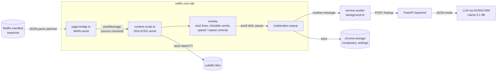

# Studium

**Click any word in a Netflix subtitle and get an explanation of what it means
*in that scene*, written for Brazilian Portuguese speakers.**

Studium is a Chrome extension (Manifest V3) with a small FastAPI backend. It
replaces Netflix's subtitles with two lines: the language you're learning, with
every word clickable, and your native language underneath. Clicking a word
pauses the video and asks an LLM for a short contextual gloss: the translation
*here*, what it means in this sentence, whether it's an idiom, and a grammar
note. Saved words go to a vocabulary list with the sentence and timestamp.

## The problem

Brazilians learning English or Italian from series hit two walls:
- Dictionary popups translate a word literally and miss what it means in the
  scene: idioms, phrasal verbs, irregular forms, false cognates.
- Switching to a translator app breaks the flow, so learners stop doing it.

The goal is to make looking something up cheaper than ignoring it.

## Architecture



**Flow.**
1. **Track discovery.** `page-bridge.ts` runs in the page's own JS context
   (`"world": "MAIN"`). It wraps `JSON.parse` to read the subtitle tracks from
   Netflix's player manifest, and wraps `JSON.stringify` to request the WebVTT
   profile. It finds the tracks by *content*, searching for known profile
   strings, not by key names, because Netflix renames internal keys.
2. **Track selection.** The isolated content script receives the track list over
   `postMessage`. It accepts only messages whose `event.source === window` and
   whose type is namespaced. It drops forced-narrative tracks and picks the target
   language (EN, IT, ES, FR, DE) and the native language (pt-BR, EN, ES).
3. **Overlay.** Both VTT files are loaded into hidden `<track>` elements, and
   `cuechange` drives the overlay. Netflix's native subtitles are hidden.
4. **Lookup.** A click pauses the video at once and sends `{videoId, timestamp,
   sentence, clickedSpan, targetLang, nativeLang}` to the service worker. Under MV3
   and Private Network Access, a content script on netflix.com can't reach
   `localhost`, but the service worker can. The worker posts to the backend, and
   the backend calls the LLM in JSON mode and validates the result into an
   `Explanation`.
5. **Never block the UI.** The popup shows "buscando…" right away. After 6 s,
   or on any error, it shows a fallback message instead of hanging. The backend
   returns a generic 502 and never forwards upstream errors to the client.

## Stack

| | |
|---|---|
| Extension | TypeScript, Vite + `@crxjs/vite-plugin`, Manifest V3, `chrome.storage` |
| Backend | Python, FastAPI, httpx, Pydantic |
| LLM | NVIDIA NIM (OpenAI-compatible), `meta/llama-3.1-8b-instruct` by default, `response_format: json_object`; override with `NVIDIA_MODEL` |
| Tests | Vitest + jsdom (extension), pytest (backend) |

## Technical decisions

- **One platform, one volatile file.** Every Netflix integration is reverse
  engineered and breaks without notice. Netflix is the only platform, and
  `page-bridge.ts` is the only file that touches Netflix internals. A manifest
  change means editing that file and its fixture-driven parser tests.
- **Patch the page's own JSON calls rather than use `chrome.debugger`.** The
  debugger permission would read response bodies cleanly, but Chrome then shows
  a permanent "this extension is debugging your browser" banner, which rules it
  out for a consumer product. Replaying Netflix's private manifest API would
  mean a much larger reverse-engineered surface.
- **Content-based manifest parsing.** Netflix has renamed internal keys before,
  so the parser looks for the shape of the data, not for the names of its keys.
- **Treat `postMessage` as untrusted.** Any script on the page can post into
  the MAIN world. Messages are namespaced and the source is checked.
- **A small model for glosses.** An 8B model answers in about 1.5 s, and the
  larger models on the free NIM endpoint often time out. A short gloss doesn't
  need a frontier model. The prompt forces every field into the user's native
  language, and JSON mode plus defensive parsing (models sometimes wrap JSON in
  prose or fences) keeps the contract stable.
- **A simulator for the inner loop.** `watch/sim.html` imitates the Netflix
  player: a canvas-backed `<video>`, a fake native subtitle layer and a fake
  manifest message. The real content script runs against it with no build, no
  extension reload and no Netflix account.

## Running it

**Demo without Netflix (simulator):**
```bash
npm install
npm run harness            # open http://localhost:5199/watch/sim.html
```
Without the backend, clicks show the fallback message. Start the backend for real explanations.

**Backend:**
```bash
cd backend
python3 -m venv .venv && source .venv/bin/activate
pip install -r requirements.txt
cp .env.example .env       # set NVIDIA_API_KEY
uvicorn main:app --port 8000
```

**Extension on real Netflix:**
```bash
npm run build              # then chrome://extensions → Developer mode → Load unpacked → dist/
```

## Tests

```bash
npm test                   # 73 tests across 15 files: manifest parsing, track selection,
                           # cue listener, tokenizer, overlay, popup, controls, bridge
                           # messages, lookup timeout/fallback, vocabulary, settings
npm run typecheck
cd backend && pytest       # LLM result mapping, 502 on upstream failure, JSON-fence parsing
```

Anything that depends on the live Netflix DOM is covered by a manual checklist,
[`docs/manual-smoke-test.md`](docs/manual-smoke-test.md), run before any release
that touches the adapter.

## Known limitations

- **Netflix can break it at any time.** The track discovery depends on internal
  player behaviour. The design limits how much code a break touches, but it
  can't prevent the break.
- **Local backend only.** The extension calls `http://localhost:8000`. There is
  no deployed backend, no auth and no per-user quota yet, so it isn't
  distributable as is.
- **No lookup cache.** Every click calls the LLM, even for the same word in the
  same scene. The cache keyed by `(videoId, timestampBucket, clickedSpan)`
  described in the spec is not built yet, and it's the main cost control
  before any public release.
- **Word-level tokenization only.** Multi-word idioms ("figure out") are
  explained from the clicked word plus the sentence, not selected as a unit.
- **Explanation quality is untested.** Backend tests mock the LLM. No eval set
  checks that glosses are correct or that the model answers in the right language.
- **Vocabulary has no review.** Saved words have no spaced repetition and stay
  on the device.
- **CORS is `*`** on the dev backend. It must be pinned to the extension
  origin before the backend runs anywhere other than localhost.

## Next steps

1. A lookup cache in the backend, with hit rate measured.
2. A small eval set of (sentence, word, expected gloss) pairs covering idioms,
   phrasal verbs and false cognates, to compare models and prompts on accuracy,
   language compliance and latency.
3. A deployed backend with auth and a free-tier quota. CORS pinned to the
   extension ID.
4. Multi-word selection for idioms.

## Docs

- [`docs/superpowers/specs/2026-07-10-netflix-adapter-design.md`](docs/superpowers/specs/2026-07-10-netflix-adapter-design.md): adapter design and rejected approaches
- [`sla-copilot-overview.md`](sla-copilot-overview.md), [`sla-copilot.md`](sla-copilot.md), [`sla-copilot_spec.md`](sla-copilot_spec.md), [`sla-copilot_plan.md`](sla-copilot_plan.md): the original product doc set (working name "SLA Copilot")
